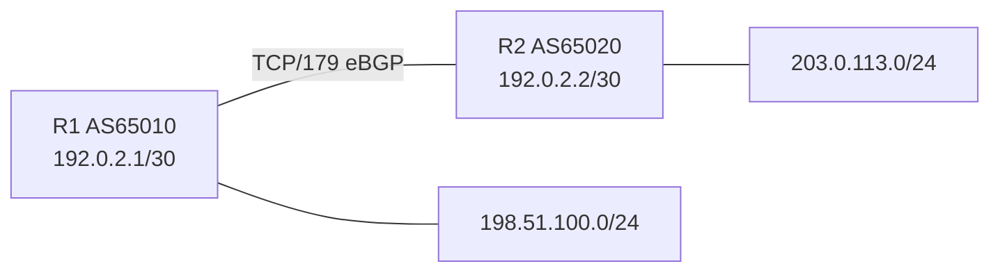

# LAB-01 — eBGP básico e anúncio de prefixos

**Objetivo:** formar uma sessão eBGP e acompanhar um prefixo desde a origem até a tabela BGP do vizinho.

## Topologia

## Endereçamento
| Nó | Interface | Endereço |
|---|---|---|
| R1 | G0/0 | 192.0.2.1/30 |
| R2 | G0/0 | 192.0.2.2/30 |
| R1 | Loopback0 | 198.51.100.1/24 |
| R2 | Loopback0 | 203.0.113.1/24 |

## Procedimento
1. Configure interfaces e confirme ping entre 192.0.2.1 e 192.0.2.2.
2. Configure os processos BGP com ASNs distintos.
3. Garanta que a rota exata 198.51.100.0/24 exista em R1 antes do comando `network`.
4. Confirme `Established` e que R2 recebe 198.51.100.0/24.
5. Faça o teste negativo: altere temporariamente o remote-as em R2, observe a falha, restaure e confirme recuperação.

## Critérios de aceitação
- Sessão Established.
- Prefixo aparece em `show ip bgp` no R2.
- Causa da falha por ASN incompatível foi identificada sem limpar a sessão antes de coletar evidências.

## Limpeza
Salve as evidências, remova a configuração BGP do lab ou restaure o snapshot.
