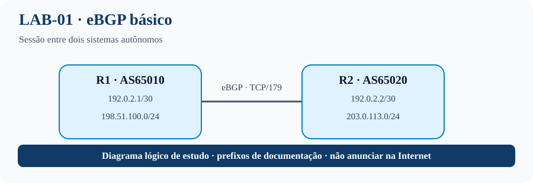
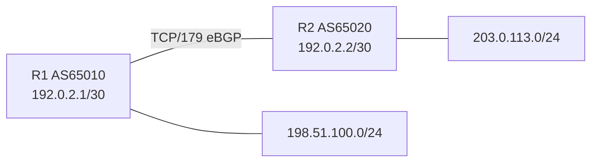

# LAB-01 — eBGP básico e anúncio de prefixos
## Topologia visual


## O que este laboratório ensina
Este é o ponto de partida para entender o BGP como protocolo de roteamento entre sistemas autônomos. Você vai separar três conceitos: conectividade IP entre vizinhos, estabelecimento da sessão TCP/179 e troca de rotas BGP. Uma sessão Established não garante, por si só, que os prefixos esperados foram anunciados ou instalados na tabela de roteamento.

**Por que isso importa em um ISP:** a mesma sequência de validação ajuda a diagnosticar novas sessões com trânsito, clientes e peers. O comando `network` origina um prefixo somente quando existe uma rota correspondente na RIB; por isso a Loopback0 cria o prefixo de teste.

**Objetivo:** formar uma sessão eBGP e acompanhar um prefixo desde a origem até a tabela BGP do vizinho.

## Topologia


## Endereçamento
| Nó | Interface | Endereço |
|---|---|---|
| R1 | G0/0 | 192.0.2.1/30 |
| R2 | G0/0 | 192.0.2.2/30 |
| R1 | Loopback0 | 198.51.100.1/24 |
| R2 | Loopback0 | 203.0.113.1/24 |

## Configurações Cisco IOS/IOS XE

> Ajuste nomes de interfaces conforme o roteador virtual (IOSv/CSR1000v). Os blocos são para laboratório isolado.

### R1 — AS65010
```cisco
hostname R1
no ip domain-lookup
interface GigabitEthernet0/0
 description eBGP-to-R2-AS65020
 ip address 192.0.2.1 255.255.255.252
 no shutdown
interface Loopback0
 description PREFIX-OWNED-BY-AS65010
 ip address 198.51.100.1 255.255.255.0
!
router bgp 65010
 bgp log-neighbor-changes
 neighbor 192.0.2.2 remote-as 65020
 !
 address-family ipv4
  network 198.51.100.0 mask 255.255.255.0
  neighbor 192.0.2.2 activate
 exit-address-family
```

### R2 — AS65020
```cisco
hostname R2
no ip domain-lookup
interface GigabitEthernet0/0
 description eBGP-to-R1-AS65010
 ip address 192.0.2.2 255.255.255.252
 no shutdown
interface Loopback0
 description PREFIX-OWNED-BY-AS65020
 ip address 203.0.113.1 255.255.255.0
!
router bgp 65020
 bgp log-neighbor-changes
 neighbor 192.0.2.1 remote-as 65010
 !
 address-family ipv4
  network 203.0.113.0 mask 255.255.255.0
  neighbor 192.0.2.1 activate
 exit-address-family
```

O comando `network` anuncia somente se o prefixo exato estiver presente na tabela de roteamento. A interface Loopback0 com máscara /24 cria essa rota conectada.

## Procedimento
1. Configure os dois roteadores e confirme `ping 192.0.2.2` a partir de R1.
2. Confirme a sessão com `show ip bgp summary`.
3. Verifique os anúncios com `show ip bgp` e `show ip route bgp`.
4. Faça o teste negativo: altere temporariamente o `remote-as` em R2, observe a falha, restaure e confirme recuperação.

## Validação
```cisco
show ip interface brief
show ip bgp summary
show ip bgp
show ip route bgp
show ip bgp neighbors 192.0.2.2 advertised-routes
```
**Esperado:** sessão Established e R2 aprendendo `198.51.100.0/24`; R1 aprendendo `203.0.113.0/24`.

## Critérios de aceitação
- Sessão Established.
- Prefixos aparecem na tabela BGP do vizinho.
- Causa da falha por ASN incompatível identificada antes de limpar a sessão.

## Limpeza
Salve as evidências, remova a configuração BGP do lab ou restaure o snapshot.
