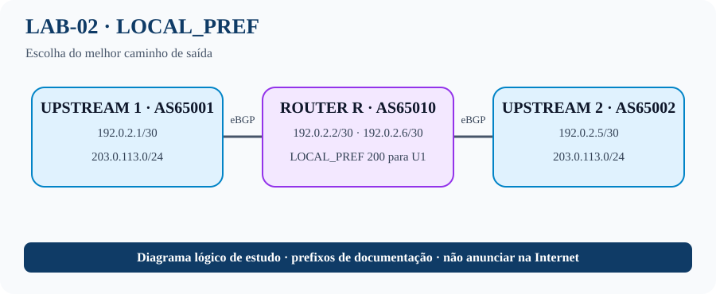

# LAB-02 — Preferência de saída com LOCAL_PREF
## Topologia visual


## O que este laboratório ensina
O cenário simula um ISP conectado a dois provedores que anunciam o mesmo destino. O atributo LOCAL_PREF permite que o AS escolha qual rota prefere para encaminhar tráfego de saída. O valor é avaliado dentro do AS e, em condições comparáveis, o maior LOCAL_PREF vence antes de atributos como AS_PATH.

**Por que isso importa em um ISP:** LOCAL_PREF pode priorizar um trânsito por custo, capacidade, contrato ou engenharia de tráfego. Ele não controla diretamente por qual caminho a Internet envia tráfego de volta; para isso, podem ser relevantes políticas de anúncio, communities e AS-path prepend. O exercício também mostra que a política deve ser aplicada no ingresso da rota em R.

**Objetivo:** escolher um upstream para o tráfego de saída quando o mesmo prefixo é aprendido por dois caminhos.

## Topologia e endereçamento
R (AS65010) liga-se a U1 (AS65001) e U2 (AS65002). U1 e U2 anunciam `203.0.113.0/24`.

| Link | R | Upstream |
|---|---|---|
| R–U1 | 192.0.2.2/30 | U1: 192.0.2.1/30 |
| R–U2 | 192.0.2.6/30 | U2: 192.0.2.5/30 |

## Configurações Cisco IOS/IOS XE

### R — AS65010 (aplicar política em U1 para preferi-lo)
```cisco
hostname R
interface GigabitEthernet0/0
 description TO-U1-AS65001
 ip address 192.0.2.2 255.255.255.252
 no shutdown
interface GigabitEthernet0/1
 description TO-U2-AS65002
 ip address 192.0.2.6 255.255.255.252
 no shutdown
!
ip prefix-list TEST-PREFIX seq 10 permit 203.0.113.0/24
route-map PREFER-U1 permit 10
 match ip address prefix-list TEST-PREFIX
 set local-preference 200
route-map PREFER-U1 permit 100
!
router bgp 65010
 bgp log-neighbor-changes
 neighbor 192.0.2.1 remote-as 65001
 neighbor 192.0.2.5 remote-as 65002
 !
 address-family ipv4
  neighbor 192.0.2.1 activate
  neighbor 192.0.2.5 activate
  neighbor 192.0.2.1 route-map PREFER-U1 in
 exit-address-family
```

### U1 — AS65001
```cisco
hostname U1
interface GigabitEthernet0/0
 ip address 192.0.2.1 255.255.255.252
 no shutdown
interface Loopback0
 ip address 203.0.113.1 255.255.255.0
!
router bgp 65001
 bgp log-neighbor-changes
 neighbor 192.0.2.2 remote-as 65010
 !
 address-family ipv4
  network 203.0.113.0 mask 255.255.255.0
  neighbor 192.0.2.2 activate
 exit-address-family
```

### U2 — AS65002
```cisco
hostname U2
interface GigabitEthernet0/0
 ip address 192.0.2.5 255.255.255.252
 no shutdown
interface Loopback0
 ip address 203.0.113.1 255.255.255.0
!
router bgp 65002
 bgp log-neighbor-changes
 neighbor 192.0.2.6 remote-as 65010
 !
 address-family ipv4
  network 203.0.113.0 mask 255.255.255.0
  neighbor 192.0.2.6 activate
 exit-address-family
```

**Nota:** use endereços de loopback distintos em U1/U2 se ambos estiverem conectados ao mesmo domínio L2; neste cenário são roteadores separados. Se a plataforma não permitir o mesmo prefixo originado simultaneamente sem conflito no desenho, use uma interface Null0 para originar a rota de teste: `ip route 203.0.113.0 255.255.255.0 Null0`.

## Tarefas
1. Configure R, U1 e U2; confirme as duas sessões eBGP.
2. Registre o melhor caminho antes de aplicar política.
3. Aplique `PREFER-U1` inbound em R e reavalie o best path.
4. Entre em `router bgp 65010` → `address-family ipv4`, remova a política com `no neighbor 192.0.2.1 route-map PREFER-U1 in` e compare.

## Validação
```cisco
show ip bgp summary
show ip bgp 203.0.113.0
show route-map
show ip bgp neighbors 192.0.2.1 received-routes
```
A exibição de rotas recebidas pode exigir `neighbor ... soft-reconfiguration inbound` ou Route Refresh. LOCAL_PREF é atributo interno ao AS e não obriga redes externas a enviarem tráfego por um upstream específico.
