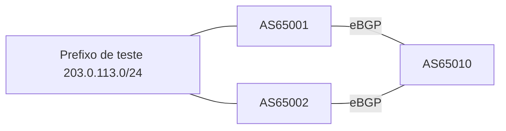

# LAB-02 — Preferência de saída com LOCAL_PREF

**Objetivo:** escolher um upstream para o tráfego de saída quando o mesmo prefixo é aprendido por dois caminhos.

## Topologia

## Tarefas
1. Anuncie o mesmo prefixo de teste a partir de U1 e U2.
2. Registre o melhor caminho antes de aplicar política.
3. Configure uma route-map inbound no peer preferido com `set local-preference 200`.
4. Reavalie o best path.
5. Remova a política e confirme retorno ao comportamento anterior.

## Evidências
Use `show ip bgp 203.0.113.0`, `show route-map` e `show ip bgp neighbors <peer> received-routes` se a plataforma suportar a exibição.

## Perguntas
- Por que LOCAL_PREF é uma escolha de saída dentro do AS?
- Por que alterar LOCAL_PREF não obriga redes externas a enviar tráfego por determinado upstream?
