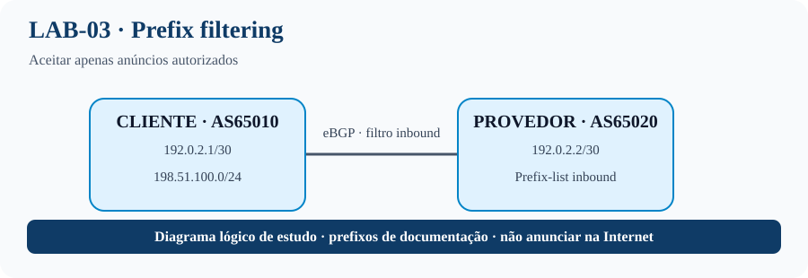

# LAB-03 — Filtragem de prefixos

> **Trilha progressiva:** Intermediário · 3/6  
> **Pré-requisito:** LAB-01 e LAB-02. Você deve conseguir estabelecer a sessão e interpretar as rotas recebidas.  
> **Objetivo de aprendizagem:** Aplicar uma política de entrada que aceite apenas os prefixos autorizados do vizinho.
## Topologia visual


## O que este laboratório ensina
O provedor recebe anúncios de um cliente e deve aceitar apenas os prefixos que o cliente está autorizado a originar. A prefix-list define o conjunto permitido; a route-map aplica essa lista ao vizinho BGP. O comportamento de negação implícita bloqueia anúncios que não correspondem às permissões.

**Por que isso importa em um ISP:** filtros evitam vazamento de rotas, anúncios acidentais de terceiros e prefixos mais específicos não autorizados. Teste tanto um prefixo permitido quanto um prefixo indevido e registre a evidência na tabela BGP e nos anúncios recebidos.

**Objetivo:** aceitar somente prefixos autorizados e testar prefixos indevidos.

## Topologia
R1 (AS65010, cliente) — eBGP — R2 (AS65020, provedor). Link: R1 192.0.2.1/30, R2 192.0.2.2/30. Prefixo autorizado: 198.51.100.0/24.

## R1 — AS65010 (origina o prefixo autorizado)
```cisco
hostname R1
interface GigabitEthernet0/0
 ip address 192.0.2.1 255.255.255.252
 no shutdown
interface Loopback0
 ip address 198.51.100.1 255.255.255.0
!
router bgp 65010
 bgp log-neighbor-changes
 neighbor 192.0.2.2 remote-as 65020
 !
 address-family ipv4
  network 198.51.100.0 mask 255.255.255.0
  neighbor 192.0.2.2 activate
 exit-address-family
```

## R2 — AS65020 (filtra o que recebe do cliente)
```cisco
hostname R2
interface GigabitEthernet0/0
 ip address 192.0.2.2 255.255.255.252
 no shutdown
!
ip prefix-list CUSTOMER-IN seq 10 permit 198.51.100.0/24
route-map CUSTOMER-IN permit 10
 match ip address prefix-list CUSTOMER-IN
!
router bgp 65020
 bgp log-neighbor-changes
 neighbor 192.0.2.1 remote-as 65010
 !
 address-family ipv4
  neighbor 192.0.2.1 activate
  neighbor 192.0.2.1 route-map CUSTOMER-IN in
 exit-address-family
```

A ausência de uma sequência permissiva final na prefix-list significa negar os demais prefixos. A route-map também tem negação implícita no final. Para testar um prefixo /25, crie uma rota de teste em R1 e anuncie-a temporariamente; o filtro deve bloqueá-la.

## Testes negativos
- Anunciar um prefixo não listado.
- Anunciar um prefixo mais específico, como 198.51.100.0/25.
- Retirar a rota autorizada e verificar que ela desaparece.

## Validação
```cisco
show ip bgp summary
show ip prefix-list CUSTOMER-IN
show route-map CUSTOMER-IN
show ip bgp
show ip bgp neighbors 192.0.2.1 received-routes
show ip bgp neighbors 192.0.2.1 routes
```
A exibição de rotas recebidas sem filtro pode exigir `soft-reconfiguration inbound` ou Route Refresh.

## Critério de aceitação
Somente o prefixo exato autorizado pode ser aceito. Documente como comprovou o bloqueio, não apenas a ausência de ping.
