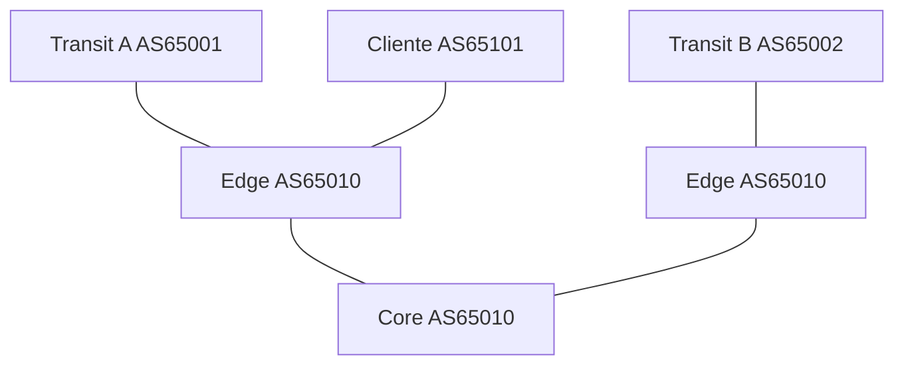

# LAB-04 — Prevenção de route leak

**Objetivo:** garantir que um AS cliente não exporte rotas aprendidas de um upstream para outro upstream sem autorização.

## Topologia

## Política
- Inbound do cliente: aceitar apenas prefixos autorizados do cliente.
- Outbound para o cliente: anunciar somente rotas contratadas.
- Outbound para upstreams: anunciar prefixos próprios e de clientes autorizados, nunca full-table aprendida de outro upstream por acidente.

## Exercício
Monte prefix-lists separadas por peer e route-maps inbound/outbound. Inspecione `advertised-routes` em cada sessão. Introduza uma linha permissiva errada e demonstre como o teste de política a detecta.

## Critério de aceitação
Nenhuma rota de Transit A é anunciada a Transit B, salvo se o cenário declarar explicitamente que o AS fornece trânsito entre eles.
