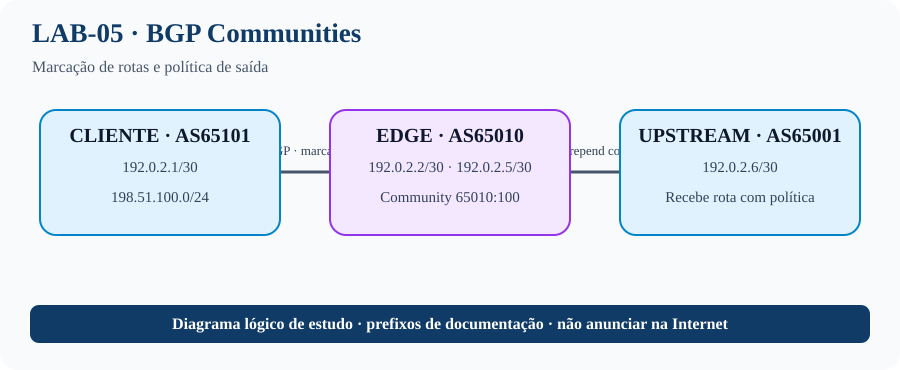

# LAB-05 — Communities como interface de política
## Topologia visual


## O que este laboratório ensina
Communities são etiquetas associadas a rotas para comunicar intenção de política entre roteadores. Neste exercício, o EDGE marca uma rota do cliente com a community standard `65010:100` e usa essa marca para selecionar uma ação de saída, como AS-path prepend. O comando `send-community` controla o envio das communities ao vizinho.

**Por que isso importa em um ISP:** communities permitem escalar políticas operacionais, por exemplo solicitar preferência menor, limitar propagação ou selecionar um upstream, quando há suporte e acordo entre as redes. Trate communities recebidas do cliente como entrada não confiável e aplique uma política clara de sanitização.

**Objetivo:** marcar rotas no ingresso e aplicar ação no egresso.

## Topologia
CUST (AS65101) — EDGE (AS65010) — UPSTREAM (AS65001). Prefixo do cliente: 198.51.100.0/24. EDGE marca o prefixo com community interna `65010:100`; a policy de saída identifica essa tag.

## CUST — AS65101
```cisco
hostname CUST
interface GigabitEthernet0/0
 ip address 192.0.2.1 255.255.255.252
 no shutdown
interface Loopback0
 ip address 198.51.100.1 255.255.255.0
!
router bgp 65101
 bgp log-neighbor-changes
 neighbor 192.0.2.2 remote-as 65010
 !
 address-family ipv4
  network 198.51.100.0 mask 255.255.255.0
  neighbor 192.0.2.2 activate
 exit-address-family
```

## EDGE — AS65010
```cisco
hostname EDGE
interface GigabitEthernet0/0
 description CUSTOMER-AS65101
 ip address 192.0.2.2 255.255.255.252
 no shutdown
interface GigabitEthernet0/1
 description UPSTREAM-AS65001
 ip address 192.0.2.5 255.255.255.252
 no shutdown
!
ip prefix-list CUSTOMER-PREFIX seq 10 permit 198.51.100.0/24
route-map CUSTOMER-IN permit 10
 match ip address prefix-list CUSTOMER-PREFIX
 set community 65010:100 additive
!
ip community-list standard CUSTOMER-TAG permit 65010:100
route-map EXPORT-CUSTOMER permit 10
 match community CUSTOMER-TAG
 set as-path prepend 65010 65010
route-map EXPORT-CUSTOMER permit 100
!
router bgp 65010
 bgp log-neighbor-changes
 neighbor 192.0.2.1 remote-as 65101
 neighbor 192.0.2.6 remote-as 65001
 !
 address-family ipv4
  network 198.51.100.0 mask 255.255.255.0
  neighbor 192.0.2.1 activate
  neighbor 192.0.2.1 route-map CUSTOMER-IN in
  neighbor 192.0.2.1 send-community
  neighbor 192.0.2.6 activate
  neighbor 192.0.2.6 route-map EXPORT-CUSTOMER out
 exit-address-family
```

## UPSTREAM — AS65001
```cisco
hostname UPSTREAM
interface GigabitEthernet0/0
 ip address 192.0.2.6 255.255.255.252
 no shutdown
router bgp 65001
 bgp log-neighbor-changes
 neighbor 192.0.2.5 remote-as 65010
 !
 address-family ipv4
  neighbor 192.0.2.5 activate
 exit-address-family
```

**Importante:** o exemplo demonstra a mecânica de community e prepend em laboratório. Em produção, valide o contrato e as políticas do provedor antes de enviar communities ou alterar AS_PATH. Evite aceitar do cliente communities reservadas à operação interna: sobrescreva tags não confiáveis no ingresso, como neste exemplo.

## Validação
```cisco
show ip bgp
show ip bgp 198.51.100.0
show ip community-list
show route-map
show ip bgp neighbors 192.0.2.6 advertised-routes
```

## Perguntas
- Qual a diferença entre standard e large communities?
- Por que `additive` preserva tags já existentes?
- Como impedir que o cliente injete uma community reservada para uso interno?
