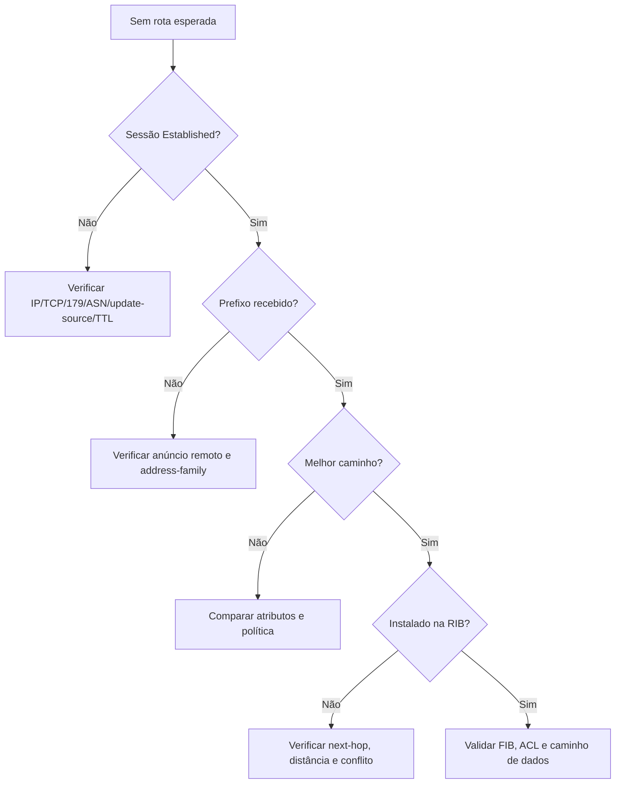

# LAB-06 — Diagnóstico em camadas

**Objetivo:** identificar a camada responsável por uma falha BGP.

## Topologia e endereçamento
R1 (AS65010) — eBGP — R2 (AS65020). R1: 192.0.2.1/30 e prefixo 198.51.100.0/24. R2: 192.0.2.2/30 e prefixo 203.0.113.0/24.

## Configuração base — R1
```cisco
hostname R1
interface GigabitEthernet0/0
 ip address 192.0.2.1 255.255.255.252
 no shutdown
interface Loopback0
 ip address 198.51.100.1 255.255.255.0
!
router bgp 65010
 bgp log-neighbor-changes
 neighbor 192.0.2.2 remote-as 65020
 network 198.51.100.0 mask 255.255.255.0
```

## Configuração base — R2
```cisco
hostname R2
interface GigabitEthernet0/0
 ip address 192.0.2.2 255.255.255.252
 no shutdown
interface Loopback0
 ip address 203.0.113.1 255.255.255.0
!
router bgp 65020
 bgp log-neighbor-changes
 neighbor 192.0.2.1 remote-as 65010
 network 203.0.113.0 mask 255.255.255.0
```

## Cenários a introduzir
1. **Interface down:** execute `shutdown` em G0/0; restaure com `no shutdown`.
2. **ASN remoto incorreto:** altere temporariamente o `remote-as` em um lado e observe o log.
3. **Prefixo ausente na RIB:** remova a Loopback0 ou a rota correspondente; o comando `network` deixa de originar o prefixo.
4. **Filtro inbound:** aplique uma prefix-list que não permita o prefixo esperado.
5. **Next-hop/instalação:** inspecione a rota BGP e a RIB para diferenciar rota aprendida de rota instalada.

## Árvore de decisão


## Comandos de evidência
```cisco
show ip interface brief
show interfaces description
show ip route
show ip bgp summary
show ip bgp
show ip bgp neighbors 192.0.2.1
show logging
```

## Entrega
Para cada cenário, anexe evidência antes/depois, hipótese, causa raiz, correção e rollback. Evite `clear ip bgp *` como primeira ação.
