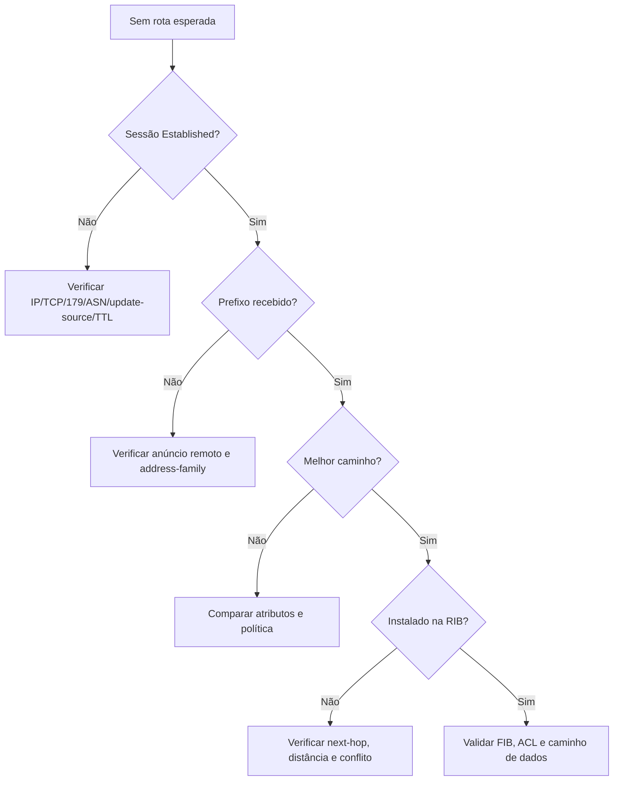

# LAB-06 — Diagnóstico em camadas

**Objetivo:** identificar a camada responsável por uma falha BGP.

## Cenários a introduzir
1. Interface down ou IP remoto inalcançável.
2. ASN remoto incorreto.
3. Prefixo não existe na RIB, embora exista comando `network`.
4. Prefixo recebido, mas bloqueado por política.
5. Next-hop inalcançável ou rota não instalada na tabela IP.

## Árvore de decisão

## Entrega
Para cada cenário, anexe evidência antes/depois, hipótese, causa raiz, correção e rollback. Evite `clear ip bgp *` como primeira ação.
