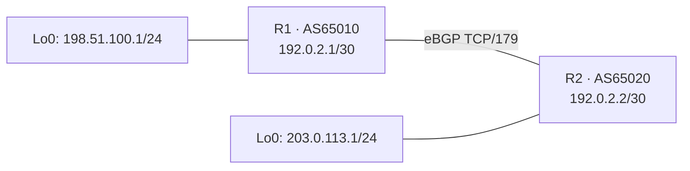
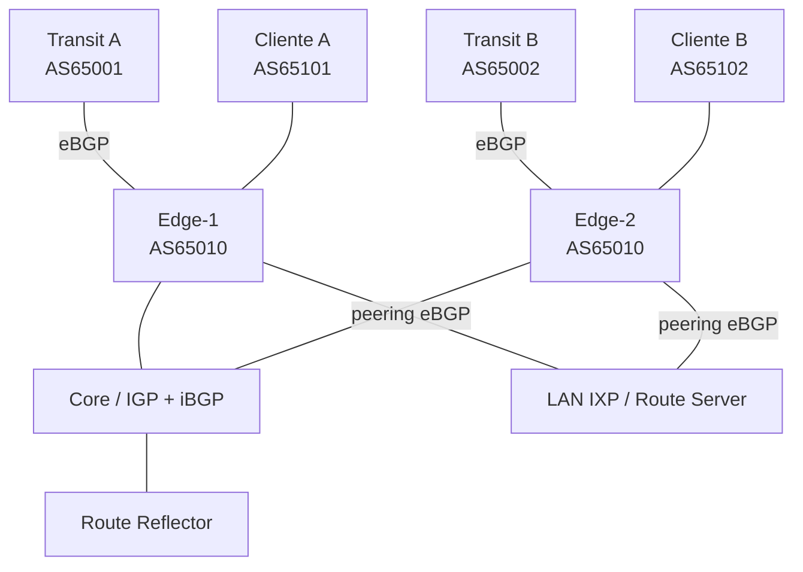
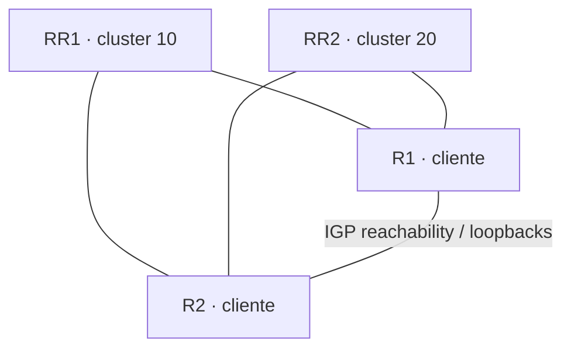
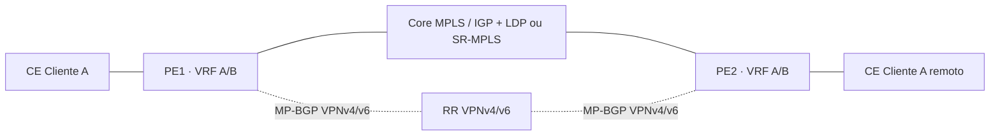

# Topologias de laboratório BGP

Os diagramas abaixo usam Mermaid, que o GitHub renderiza diretamente. Eles são desenhos lógicos editáveis por texto; os endereços são reservados para documentação e não devem ser anunciados publicamente.

## 1. eBGP básico — dois AS

## 2. ISP multihomed com dois upstreams e IXP

## 3. iBGP com dois route reflectors

## 4. MPLS L3VPN conceitual

## 5. Plano de endereçamento de laboratório
| Enlace | Endereços | Uso |
|---|---|---|
| R1—R2 | 192.0.2.1/30, 192.0.2.2/30 | eBGP básico |
| R1—R3 | 192.0.2.5/30, 192.0.2.6/30 | segundo upstream |
| LAN cliente A | 198.51.100.0/24 | prefixo anunciado no lab |
| LAN cliente B | 203.0.113.0/24 | prefixo anunciado no lab |
| IPv6 de documentação | 2001:db8::/32 | exemplos IPv6 |

## 6. Como gerar imagens
Para exportar diagramas como SVG/PNG, use Mermaid CLI ou um editor Mermaid aprovado pela sua organização. Mantenha também o `.md`/`.mmd` versionado para que o desenho continue editável.

## Topologias visuais individuais dos laboratórios

Os diagramas SVG abaixo estão versionados no repositório e podem ser incorporados aos guias Markdown. Para editar, altere o arquivo SVG correspondente.

- [LAB-01 — eBGP básico](lab-01.svg)
- [LAB-02 — LOCAL_PREF](lab-02.svg)
- [LAB-03 — Prefix filtering](lab-03.svg)
- [LAB-04 — Prevenção de route leak](lab-04.svg)
- [LAB-05 — BGP Communities](lab-05.svg)
- [LAB-06 — Troubleshooting](lab-06.svg)

Os diagramas representam a topologia lógica para estudo. Antes de montar o laboratório no EVE-NG/GNS3, confirme a quantidade de interfaces disponíveis na imagem de roteador e replique o endereçamento descrito em cada guia.
